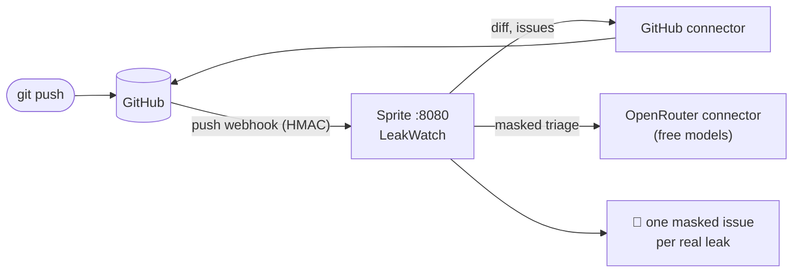

# LeakWatch 🔑

**A personal agent on a Fly.io Sprite. It watches your GitHub pushes and opens a masked issue the moment you commit a real secret.**

## The problem

- GitHub **push protection is free and on by default only for public repos**, and it only knows token formats with a recognizable prefix. Private repos need paid **GitHub Secret Protection**.
- AI-assisted commits leak secrets at **roughly twice the baseline rate** (GitGuardian, *State of Secrets Sprawl 2026*).

LeakWatch covers **private repos** and **generic secrets**: passwords, connection strings, high-entropy values assigned to `*_SECRET`/`*_TOKEN`. Its own credentials never touch the Sprite's disk, because the **Sprites connectors** inject them at the gateway.

## How it works



1. GitHub sends a `push` webhook to the Sprite's public URL. LeakWatch checks the HMAC signature and replies `202`.
2. It fetches the commit diff **through the GitHub connector** and scans **only added lines**: 11 known formats (AWS, GitHub, OpenAI, Anthropic, Stripe, Slack, Google, PEM private keys, DB URLs with passwords) plus a generic rule (suspicious name + length > 8 + Shannon entropy ≥ 3.5).
3. Cheap filters drop obvious placeholders (`your-key-here`, `changeme`, `${VAR}`, `os.environ[...]`, …).
4. An LLM **through the OpenRouter connector** (`:free` models only) separates real leaks from placeholders. It sees only the **masked** value (`AKIA…XY`) and masked context, never the secret. If every model is down, LeakWatch falls back to rules-only and still reports high-confidence matches.
5. One GitHub issue per real finding: type, file:line, commit, masked value, why, rotation steps, and how to purge history. A SHA-256 fingerprint in SQLite means the same secret is never reported twice.

The tone is a deadpan "security uncle" (*"A private key is like a toothbrush. You don't share it, and you definitely don't push it."*). Set `tone = "professional"` to turn it off.

### Why connectors matter

There's no `GITHUB_TOKEN` or `OPENROUTER_API_KEY` anywhere: not in the code, env, files or this repo. The Sprite calls `https://api.sprites.dev/v1/gateway/<provider>/<connection>/...` and the gateway adds the credentials, gated by an access policy on the Sprite's name prefix (`leakwatch`). `gateway.py` actively **refuses** to send an `Authorization` header. The only secret LeakWatch creates is its own webhook HMAC key (`data/webhook_secret`, mode 600, gitignored).

## Setup (5 steps)

1. **Sprite and connectors.** Create a Sprite whose name starts with `leakwatch` (`sprite create leakwatch-dev`). In the Fly dashboard → Connectors, add **GitHub** (OAuth, scope `repo`) and **OpenRouter**, each with access policy *name prefix = `leakwatch`*.
2. **Public URL**, so GitHub can deliver webhooks (from your laptop): `sprite url update --auth public -s leakwatch-dev`. That form is deprecated; its replacement is `sprite config update --url-auth …`.
3. **Install** (inside the Sprite):
   ```bash
   git clone https://github.com/alhaiqi/leakwatch.git ~/leakwatch && cd ~/leakwatch
   python3 -m venv .venv && .venv/bin/pip install -e '.[dev]'
   $EDITOR config/leakwatch.toml        # set [watch] repos = ["you/your-private-repo"]
   ```
4. **Run it as a Sprite service and register the webhook:**
   ```bash
   sprite-env services create leakwatch --cmd "$PWD/.venv/bin/leakwatch" --args serve --dir "$PWD" --http-port 8080
   .venv/bin/leakwatch register-webhook
   ```
5. **Check:** `.venv/bin/leakwatch doctor` (all ✅), then `.venv/bin/python -m pytest` for the offline tests.

## Usage

```bash
leakwatch doctor [--deep]                    # connectors, service, public URL, webhook, heartbeat
leakwatch serve [--poll 60]                  # webhook server on :8080 (or the polling fallback)
leakwatch register-webhook [owner/repo]      # creates or updates exactly one hook
leakwatch scan-commit owner/repo <sha>       # scan one commit now
leakwatch scan-recent owner/repo --n 5       # catch up on recent commits (idempotent)
leakwatch self-scan [path]                   # scan a working tree; this repo scans clean
scripts/e2e.sh                               # live end-to-end test against the test repo
scripts/demo_seed.py leak|placeholder|duplicate|cleanup --wait 90
```

## Testing

- `pytest`: **144 offline tests**, 98% coverage of `scanner/`, zero false positives on the placeholder fixtures. Fake secrets are generated at runtime by `tests/fakes.py`; fixtures hold only `{{FAKE_*}}` tokens.
- `pytest -m live`: gateway, LLM triage and forced-failure tests against the real connectors.
- `scripts/e2e.sh`: positive, negative, dedupe and robustness through the real webhook. It passed 3× in a row; see [docs/TEST_REPORT.md](docs/TEST_REPORT.md).

## Limitations

- Scans new pushes only: no history scanning, no automatic rotation, one user.
- The commits API caps a diff at 300 files; files without a `patch` (binary or huge) are skipped.
- A real secret that contains placeholder-looking words (`example`, `your`, …) can be filtered out. Generic hits need the LLM to say `real`; in rules-only mode only known formats are reported.
- Free LLMs are rate-limited and sometimes wrong. A low-confidence "placeholder" verdict can't suppress a known-format hit.
- Always-on service: per the Sprite docs a running service keeps the Sprite awake. That trades cost for reliability (see `docs/DECISIONS.md`, ADR-0003 and ADR-0008).
- Deleting `data/` resets dedupe, so old secrets get re-reported.

## Docs

[Architecture](docs/ARCHITECTURE.md) · [Decisions](docs/DECISIONS.md) · [Debug log](docs/DEBUG_LOG.md) · [Test report](docs/TEST_REPORT.md) · [Manual test](docs/MANUAL_TEST.md) · [Demo script](docs/DEMO_SCRIPT.md)

**Demo video:** _link to be added after recording_

---

Built for **Fly.io Hacksgiving 2026**, on a Sprite, with two Sprites connectors (GitHub and OpenRouter).
