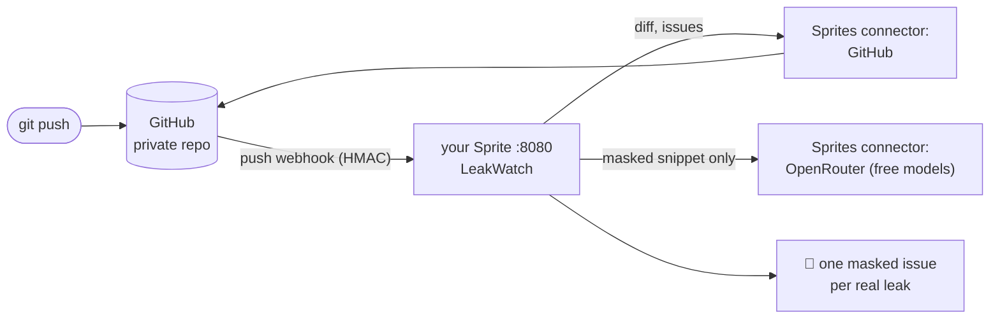

# LeakWatch 🔑

**A personal security agent you own: it watches your private repos for leaked keys, runs on your own Sprite, and holds zero credentials itself.**

Push a commit with a real key and LeakWatch opens one masked GitHub issue that says what leaked, where, and how to rotate it in plain language. Push a placeholder and it stays quiet.

## Why

- **Self-hosted, so your code isn't sent to a third-party scanner.** LeakWatch runs on *your* Fly.io Sprite. It reads diffs from GitHub and scans them locally. The only thing that leaves is a **masked** snippet (`AKIA…XY` plus up to 3 masked context lines) sent to an LLM for triage. The full secret and the rest of your code never do.
- **Zero stored credentials.** There's no `GITHUB_TOKEN` and no `OPENROUTER_API_KEY` on the machine. **Sprites Connectors** inject the credentials at the gateway, scoped by a policy on the Sprite's name. A compromised Sprite has no token to steal.
- **LLM triage of real vs placeholder.** Regex and entropy find candidates; a free model decides whether `sk-…` is a live key or `sk-your-key-here`. If the LLM is down, rules-only mode still reports high-confidence formats.
- **Plain-language rotation steps** in every issue, plus how to purge the value from history.

**Why now** (sources linked by name):
- Commits co-authored by Claude Code leak secrets at **about twice the baseline rate**. *(GitGuardian, State of Secrets Sprawl 2026)*
- **64%** of secrets confirmed valid in 2022 were **still exploitable in early 2026**. Leaks get found long after they happen; rotation is what fixes them. *(GitGuardian, State of Secrets Sprawl 2026)*
- GitHub **push protection for users is on by default only for public repositories**. Private repos need someone to turn something on. *(GitHub Docs, push protection)*

## How LeakWatch compares

LeakWatch is a small, personal, self-hosted backstop. Mature tools exist, and for many people they're the better choice:

| | LeakWatch | GitGuardian (Internal Monitoring) | GitHub Secret Protection | Pre-commit: gitleaks / ggshield |
|---|---|---|---|---|
| Private repos | ✅ | ✅ **free for individual developers and teams under 25** | ✅ paid add-on (per active committer) | ✅ (local) |
| Where scanning happens | your Sprite | GitGuardian's SaaS | GitHub | your laptop (ggshield calls GitGuardian's API) |
| When | after push (webhook) | after push, plus history | **before** push (push protection) and after | **before** commit |
| Detectors | 11 formats + generic entropy rule + LLM triage | hundreds, with validity checks | many partner patterns, with validity checks | hundreds (gitleaks rules / GitGuardian) |
| History scan, dashboard, team workflows | ❌ | ✅ | ✅ | n/a |
| Credentials the tool holds | **none** (Sprites Connectors) | a GitHub App installation | built in | none / a GitGuardian API key |

**Use those instead (or as well) when:**
- **You want breadth, history scanning, validity checks or a team dashboard:** use **GitGuardian**. It's free for individuals and small teams, covers private repos, and has far more detectors than LeakWatch.
- **You're on an organization plan and want leaks *blocked* at push time:** use **GitHub Secret Protection**.
- **You control every machine that commits:** install a **pre-commit hook (gitleaks or ggshield)**. Stopping the secret before it leaves your laptop beats any after-the-fact alert. LeakWatch is useful *alongside* hooks, for commits made where hooks aren't installed: AI coding agents, a second machine, edits in the GitHub web UI.

**LeakWatch fits when** you want a personal watcher that you run yourself, where no third-party scanner gets read access to your private code and the agent holds no credentials at all.

## How it works



1. GitHub sends a `push` webhook to the Sprite's public URL. LeakWatch checks the HMAC signature and replies `202`.
2. It fetches the commit diff **through the GitHub connector** and scans **only added lines**: 11 known formats (AWS, GitHub, OpenAI, Anthropic, Stripe, Slack, Google, PEM private keys, DB URLs with passwords) plus a generic rule (suspicious name + length > 8 + Shannon entropy ≥ 3.5).
3. Cheap filters drop obvious placeholders (`your-key-here`, `changeme`, `${VAR}`, `os.environ[...]`, …).
4. An LLM **through the OpenRouter connector** (`:free` models only) separates real leaks from placeholders. It sees only the masked value and masked context, never the secret. If every model is down, LeakWatch falls back to rules-only and still reports high-confidence matches.
5. One GitHub issue per real finding: type, file:line, commit, masked value, why, rotation steps, and how to purge history. A SHA-256 fingerprint in SQLite means the same secret is never reported twice.

The tone is a deadpan "security uncle" (*"A private key is like a toothbrush. You don't share it, and you definitely don't push it."*). Set `tone = "professional"` to turn it off.

### Zero credentials, concretely

The Sprite calls `https://api.sprites.dev/v1/gateway/<provider>/<connection>/...` and the gateway adds the credentials, gated by an access policy on the Sprite's name prefix (`leakwatch`). Connection IDs are discovered at startup from `/v1/gateway/list`. `gateway.py` actively **refuses** to send an `Authorization` header, and `leakwatch doctor` checks that no token variables are set. The only secret LeakWatch creates is its own webhook HMAC key (`data/webhook_secret`, mode 600, gitignored). See [ARCHITECTURE.md](docs/ARCHITECTURE.md#trust-boundaries-who-sees-what) for exactly what each party sees.

## Setup (5 steps)

1. **Sprite and connectors.** Create a Sprite whose name starts with `leakwatch`: `sprite create leakwatch-dev`. In the Sprites dashboard (sprites.dev → your org → **Connectors**), add **GitHub** (OAuth, scope `repo`) and **OpenRouter**, each with access policy *name prefix = `leakwatch`*. LeakWatch only uses `:free` models, so a $0 OpenRouter account works.
2. **Make the Sprite URL public**, so GitHub can deliver webhooks. Run this where the `sprite` CLI is logged in (`sprite login`), usually your laptop. The CLI inside the Sprite isn't logged in.
   ```bash
   sprite config update --url-auth public -s leakwatch-dev
   # older CLIs (deprecated, same effect):  sprite url update --auth public -s leakwatch-dev
   ```
   Every webhook must carry a valid HMAC signature (anything else gets 401), so a public URL exposes nothing.
3. **Install** (inside the Sprite: `sprite console -s leakwatch-dev`). Replace `OWNER/REPO` with your private repo:
   ```bash
   git clone https://github.com/alhaiqi/leakwatch.git ~/leakwatch
   cd ~/leakwatch
   python3 -m venv .venv
   .venv/bin/pip install -e '.[dev]'
   sed -i 's#"alhaiqi/leakwatch-playground"#"OWNER/REPO"#' config/leakwatch.toml
   ```
4. **Run it as a Sprite service and register the webhook:**
   ```bash
   cd ~/leakwatch
   sprite-env services create leakwatch --cmd "$HOME/leakwatch/.venv/bin/leakwatch" --args serve --dir "$HOME/leakwatch" --http-port 8080
   .venv/bin/leakwatch register-webhook
   ```
5. **Check:** `.venv/bin/leakwatch doctor` should show every line ✅. If "public URL /healthz" shows `302`, step 2 didn't take effect. Then run `.venv/bin/python -m pytest` for the offline tests.

## Usage

Inside the Sprite, `cd ~/leakwatch && source .venv/bin/activate` (or prefix commands with `.venv/bin/`):

```bash
leakwatch doctor [--deep]                    # connectors, service, public URL, webhook, heartbeat
leakwatch serve [--poll 60]                  # webhook server on :8080 (or the polling fallback)
leakwatch register-webhook [owner/repo]      # creates or updates exactly one hook
leakwatch scan-commit owner/repo <sha>       # scan one commit now
leakwatch scan-recent owner/repo --n 5       # catch up on recent commits (idempotent)
leakwatch self-scan [path]                   # scan a working tree; this repo scans clean
scripts/e2e.sh                               # live end-to-end test against the test repo
python scripts/demo_seed.py leak|placeholder|duplicate|cleanup --wait 90
```

## Testing

- `pytest`: **148 offline tests**, 98% coverage of `scanner/`, zero false positives on the placeholder fixtures. Fake secrets are generated at runtime by `tests/fakes.py`; fixtures hold only `{{FAKE_*}}` tokens.
- `pytest -m live`: gateway, LLM triage and forced-failure tests against the real connectors.
- `scripts/e2e.sh`: positive, negative, dedupe and robustness through the real webhook. It passed 3× in a row on the final code; see [docs/TEST_REPORT.md](docs/TEST_REPORT.md).

## Limitations

- Scans new pushes only (no history scan), one user, no automatic rotation. It alerts after the push; it doesn't block it.
- 11 formats plus one generic rule is far fewer detectors than GitGuardian or gitleaks, and it does no validity checks.
- The commits API caps a diff at 300 files; files without a `patch` (binary or huge) are skipped.
- A real secret that contains placeholder-looking words (`example`, `your-key`, …) can be filtered out. Generic hits need the LLM to say `real`; in rules-only mode only known formats are reported.
- The generic rule needs Shannon entropy ≥ 3.5. A short random password (around 18 characters) falls below that about 0.6% of the time because of repeated characters, and is then missed (measured, DEBUG_LOG #8).
- Free LLMs are rate-limited and sometimes wrong. A low-confidence "placeholder" verdict can't suppress a known-format hit.
- Always-on service: per the Sprite docs a running service keeps the Sprite awake. That trades cost for reliability (ADR-0003 and ADR-0008).
- Deleting `data/` resets dedupe, so old secrets get re-reported.

## What's next

- **GitHub App for one-click, multi-user install.** Each user installs the app on chosen repos instead of editing a config file; webhooks and permissions come with the installation.
- **History scan:** a one-off `leakwatch scan-history owner/repo`, reusing the same scanner, dedupe and masking, for secrets that were committed before LeakWatch was watching.
- **Optional auto-rotation hooks:** per-type hooks (for example "deactivate this AWS key via a Sprites connector") that only run when you opt in. They'd stay off by default, because rotating the wrong key is its own outage.

## Docs

[Architecture](docs/ARCHITECTURE.md) · [Decisions](docs/DECISIONS.md) · [Debug log](docs/DEBUG_LOG.md) · [Test report](docs/TEST_REPORT.md) · [Manual test](docs/MANUAL_TEST.md) · [Demo script](docs/DEMO_SCRIPT.md)

**Demo video:** _link to be added after recording_

---

Built for **Fly.io Hacksgiving 2026**, on a Sprite, with two Sprites connectors (GitHub and OpenRouter).
