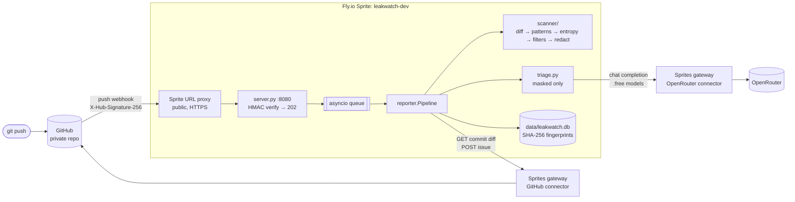

# Architecture

## Components

| Module | Job |
|---|---|
| `server.py` | Starlette app on :8080. Verifies HMAC-SHA256 with `data/webhook_secret` (mode 600) and answers 202 straight away (`ping` gets 200, other events are ignored, bad signatures get 401, oversized bodies 413). One worker drains the queue; a heartbeat task writes `data/heartbeat.log`; `--poll N` is the polling fallback |
| `gateway.py` | Discovers connections from `/v1/gateway/list` (cached to `data/gateway-cache.json` in case discovery fails later). A request hook refuses to send `Authorization`/`X-Api-Key` |
| `github.py` | REST calls through the GitHub connector. Every write checks the allowlist; e2e branches must start with `leakwatch-e2e-`; closing an issue requires the `leakwatch-e2e` label |
| `scanner/` | Pure and offline: `diff.py` (new-file line numbers, skips lockfiles, vendored and binary files, and anything over 1 MB), `patterns.py` (11 known formats plus the generic rule), `entropy.py`, `filters.py` (placeholders, code expressions, test-path penalty), `redact.py` (`mask`, `scrub`), `detector.py` (`Finding` keeps the raw value in a private field that's left out of repr, `to_dict` and context) |
| `triage.py` / `llm.py` | Masked prompt → strict JSON. Free models only, falling over to the next on 429/5xx/timeout/empty; retry once on malformed output; rules-only fallback |
| `reporter.py` | Decision policy, issue rendering (security-uncle or professional tone), and `Pipeline.process_commit` |
| `store.py` | SQLite: `fingerprints` (hash, file, type, issue URL), `processed` (repo, sha), `runs` (log) |

## Data flow for one push

1. GitHub POSTs `push` to `https://<sprite>.sprites.app/github/webhook`.
2. The server checks the HMAC (constant-time compare), the allowlist and branch deletion, enqueues `(repo, sha, ref)` for each commit and replies 202. Measured response time is milliseconds.
3. The worker calls `GET /repos/{r}/commits/{sha}` and scans only the `+` lines of each file's `patch`.
4. For each candidate: fingerprint = `sha256(repo \0 file \0 secret)`. If it's already in the DB, skip it (dedupe happens before any LLM call).
5. Triage: the LLM gets the masked value, ≤3 scrubbed context lines and non-revealing features (type, length, entropy, placeholder marker, test path).
6. Decide (ADR-0006): report `real`; report `unsure` when rule confidence is ≥ 0.8; a low-confidence LLM `placeholder` can't suppress a known-format hit.
7. Atomically claim the fingerprint, then create the issue (falling back to a commit comment on 403/404/410). The claim is released if both fail.

## Trust boundaries: who sees what

| Party | Sees | Never sees |
|---|---|---|
| GitHub (issue) | masked value `AKIA…XY`, file, line, commit, type, rotation steps | the full value |
| OpenRouter / LLM | masked value, ≤3 masked+scrubbed context lines, file path, local features | the raw value (an `assert` in `build_messages` enforces it) or unmasked context |
| SQLite DB | SHA-256 fingerprint, file, type, commit, issue URL | the raw value (a unit test checks the DB bytes) |
| Logs | `Finding(...)` repr with the masked value; every record goes through `scrub()` | the raw value |
| Sprite disk | the webhook HMAC secret (`data/webhook_secret`, 600) | GitHub/OpenRouter credentials, which the gateway injects |

Fingerprints are kept out of public issue bodies, because a hash of a weak password can be brute-forced (ADR-0005).

## Failure modes and fallbacks

| Failure | Behaviour |
|---|---|
| All free models 429/5xx/timeout, or bad JSON twice | Rules-only: verdict `unsure` at rule confidence. Known formats (≥ 0.8) are still reported; generic hits (0.6) are not |
| Issue creation forbidden | Commit comment on the exact line; if that fails too, the claim is released and the error logged |
| Server crash | `sprite-env` service restarts it (proven: back in under 5 s) |
| Sprite reboot | Services restart at boot (documented). The heartbeat records the new boot_id |
| Missed webhook delivery | `leakwatch scan-recent <repo> --n 20` (idempotent thanks to dedupe), or redeliver from the repo's webhook settings |
| Webhook can't reach the Sprite | `leakwatch serve --poll 60` polls `GET /commits` and prints a stdout heartbeat |
| Gateway 401/403 | Logged with a hint: check the Sprite name prefix `leakwatch` against the connector policy |
| `/v1/gateway/list` down | Uses the cached discovery |
